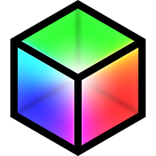

<p align="center">
  
</p>

# DesktopLUT

DesktopLUT applies color corrections to the entire Windows desktop in real time using a three-layer system. It works with any DirectX 11 GPU and supports both SDR and HDR modes.

## How the three layers work

DesktopLUT uses the following layers, which can be enabled individually or together:

1. **MHC (GPU-level)**
   Installs color corrections directly at the graphics card driver level via ICC profiles. Handles primaries mapping, white balance, grayscale correction, and desktop gamma. This layer remains active even when DesktopLUT is not running. While running, DesktopLUT also watches for Windows silently dropping the calibration (a known issue with calibration tools, GPU control panels, sleep/wake, etc.) and re-applies it automatically.

2. **3D LUT + Tonemapping (DWM hook)**
   Applies a volumetric color correction using a loaded .cube file, plus ICtCp HDR tone mapping with dynamic peak detection. With DWM Hook mode on, both run inside DWM with no overlay. With it off, an overlay applies them.

3. **Analysis overlay**
   Real-time frame analysis (luminance, gamut, HDR histogram, timing stats), activated on demand via hotkey. In DWM Hook mode it is the only component that uses Desktop Duplication.

Tone mapping, the 3D LUT and FALD run first, inside DWM (or in the overlay). The MHC profile comes after them, at scanout. The interface draws this order for each display as its pixel path.

## Requirements

- Windows 10 (version 21H2 or newer) or Windows 11
- DirectX 11 compatible GPU (NVIDIA, AMD, or Intel)
- Recommended: Enable "Auto Color Management" in Windows display settings

## Installation

1. Download `DesktopLUT.exe` and `DwmHook.dll` from the [Releases page](https://github.com/sup3rflyer/DesktopLUT/releases) and place them in the same folder.
2. Run the executable (no installer is required).
3. The window opens. With **Start minimized** on, DesktopLUT starts in the system tray instead; click the tray icon to open it.

**Upgrading:** exit DesktopLUT, then replace `DesktopLUT.exe` and `DwmHook.dll` in the folder you already use. Your settings are in `DesktopLUT.ini` next to the exe. If you start the new version from a different folder, copy `DesktopLUT.ini` there first: without it DesktopLUT starts with empty settings and removes the MHC profiles the old copy installed.

## Changing DesktopLUT with an AI assistant

The release is a ready-made build. The source is here so you can change it. You can point an AI coding assistant at this repository and have it adapt DesktopLUT to your display and workflow.

- Start with **[AGENTS.md](AGENTS.md)**: how to build and test, where things live, and the rules a change must keep.
- The DWM hook runs inside `dwm.exe`. A careless change there can black out or crash the desktop. Make and test changes in overlay mode first (Settings → **DWM HOOK** off).
- MHC profiles are installed system-wide and stay after DesktopLUT exits. Back up your INI and note your installed profiles before testing a build.
- [DLC](DLC/) in this repository already works this way: a calibrator whose runs an LLM assistant supervises.

## The interface

The window lists your displays on the left, with each display's mode (HDR, SDR or SDR · ACM), a light per layer and its resolution. Double-click a display to rename it. Displays that are not connected stay in the list as OFFLINE, with their settings.

It has four pages:

- **PIPELINE**: the selected display's pixel path, DESKTOP → TONE MAP (HDR only) → 3D LUT → FALD (shown as **+ FALD** until a panel file is set) → SCANOUT → PRIMARIES → GRAYSCALE → PANEL. Click a stage to open its settings. Each stage has its own switch; switching it off keeps its settings. The **HDR / SDR** switch at the top right shows the settings of either mode. The **MEASURED** column beside it shows what DLC last measured on the display, if you use DLC.
- **DLC**: a calibration run in progress and the calibration record of each display (see [Calibrating with DLC](#calibrating-with-dlc-desktoplut-calibrator)).
- **EVENTS**: a log of what DesktopLUT did. **ALL OUTPUT** adds the diagnostic log.
- **SETTINGS**: interface, theme, startup, engine, calibration, hotkeys, console log, about.

The lights on each stage:

| Light | Meaning |
|-------|---------|
| none | nothing set |
| ring | set, but switched off or suspended |
| filled | changing the picture now |
| amber | should run, but does not reach the screen |

**LIVE LAYERS** (top right) replaces the old Start / Stop buttons. The 3D LUT, tone mapping and FALD run whenever they are configured. Switch LIVE LAYERS off to suspend them; MHC profiles stay on. The tray menu has the same switch ("Suspend live layers").

Three themes are built in: Dark, Gray and Light (Settings → **THEME**).

The previous window is still available: Settings → **INTERFACE** → **CLASSIC**, or the tray's "Classic interface" item. Two things are only there for now: the FALD LED-lag timing fields and the twin-monitor LUT routing tools. The DLC page, the event log, the themes and REFRESH TRIM are only in the new interface.

## Common setups

Select the display in the list first. The steps below use the new interface; in the classic window the same controls are on the **I. MHC**, **II. 3D LUT** and **III. Corrections** tabs.

### 1. Correct SDR content in HDR mode
This fixes washed-out SDR content (desktop, apps) while Windows is in HDR.

1. On **PIPELINE**, select the display's HDR side and click **GRAYSCALE**.
2. Switch **DESKTOP GAMMA** on. It shows SDR content as gamma 2.2 at your Windows SDR content brightness. If the display has no MHC profile yet, a neutral one is created to carry it.
3. **Win + Shift + G** toggles it.
4. Add video players and games to its **WHITELIST**, so it turns off while they run.

### 2. Apply basic color correction using MHC
1. On **PIPELINE**, click **PRIMARIES**, then **EDIT…**.
2. Switch **PRIMARIES** on and click **DETECT** to read the primaries the display reports (or pick a preset, type them, or drag them on the diagram). **IMPORT…** takes an ICC profile or a 1D .cube instead.
3. Click **DONE**. The profile is installed.
4. Optional: **WHITE BALANCE** in the PRIMARIES panel, and **GRAYSCALE** → **FINE-TUNE** → **EDIT CURVE…** for the grayscale.

This correction stays active at the GPU level, even when DesktopLUT is not running.

### 3. Use a measured 3D LUT
1. Keep the MHC layer active (if used).
2. Generate a .cube file (33³ or 65³) with your calibration software while MHC is enabled.
3. On **PIPELINE**, pick the mode (HDR or SDR), click **3D LUT**, then **BROWSE…** and choose the file.

With DWM Hook mode on (Settings → **DWM HOOK**; the default on Windows 11), the 3D LUT is applied inside DWM without an overlay.

### 4. HDR tone mapping
1. On **PIPELINE**, select the display's HDR side and click **TONE MAP**. Switch it on.
2. Choose a **CURVE** (BT.2390, BT.2446A, Reinhard, Soft Clip, Hard Clip).
3. Set **DISPLAY PEAK** to your panel's peak. Set **CONTENT PEAK** to **DYNAMIC** (measured from each frame) or **FIXED** at a value.
4. Leave **WINDOWS TONE MAP** on **AUTO**, so games and apps do not tone map a second time.
5. Use the analysis overlay (**Win + Shift + X**) to inspect the result.

### 5. Measure and calibrate with a colorimeter (DLC)
Use the **DesktopLUT Calibrator** in this repository's `DLC/` folder to measure your display and install a matched MHC profile and 3D LUT. It is not part of the release zip. See the next section.

## Calibrating with DLC (DesktopLUT Calibrator)

[`DLC/`](DLC/) is a Python calibrator that measures your display with a colorimeter and installs the result into DesktopLUT: an **MHC ICC profile** (white point + grayscale, at the GPU) and a **3D LUT** (colour), for SDR and HDR. DLC is optional. DesktopLUT works without it.

DLC is operated by an **LLM agent** (e.g. Claude Code launched in `DLC/`) with you in the loop. A scripted core does all the measuring and maths. The agent judges each decision point and keeps you informed. There are no unattended hardware runs.

You need:
- a colorimeter (DLC is developed with the i1Display Pro family; a spectrometer is optional, for meter corrections);
- Python 3.11+, ArgyllCMS 3.3.0 and dogegen (placed under `DLC/third_party/`);
- DesktopLUT 3.0 or newer with its **calibration pipe armed**: Settings → **CALIBRATION** → **DLC CONTROL** (classic window: Settings tab → *Experimental* → *Calibration control (DLC)*), the tray's "Calibration control", or an empty `DesktopLUT_Calibration.flag` next to the exe. It is off by default; turn it off when you are done.

DesktopLUT shows what DLC did:
- The **DLC** page follows a run in progress: stage, patches, live error and time left, with **PAUSE** / **RESUME** and **CANCEL** (cancel restores your setup from before the run). Decisions at the run's seams are made by the agent and shown here read-only. **COPY PROMPT** gives a ready-made request for the agent.
- After a run, the **DLC** page shows each display's calibration record with charts, and **MEASURED** on PIPELINE shows the latest verification. A **RECAL** badge appears when it is older than the reminder (Settings → **CALIBRATION** → **REMINDER**, 90 days by default).
- DesktopLUT finds DLC by itself when the `DLC` folder is next to `DesktopLUT.exe`, or one or two folders up (a build from this repository in `bin\Release`). It remembers where it last found it. Anywhere else: Settings → **CALIBRATION** → **DLC FOLDER**.
- A display's DLC record can also hold how its brightness changes with the refresh rate. DesktopLUT then trims the HDR profile for the rate the display runs at (see **REFRESH TRIM** under [Grayscale correction](#grayscale-correction)).

Start with **[DLC/README.md](DLC/README.md)** (setup + the example profile). The agent's operating manual is **[DLC/docs/operator-guide.md](DLC/docs/operator-guide.md)**.

## FALD compensation (experimental, mini-LED only)

FALD compensation is an experimental layer for full-array local-dimming LCDs (mini-LED). It models the panel's backlight zones and pre-corrects each pixel against the panel's own local-dimming errors: the bright and dark rings it puts around highlights. It is **off by default** and does nothing without a panel file.

- It needs a **panel file fitted to your own monitor**. DLC's FALD profile flow makes one with a colorimeter (about 40 minutes of measuring, then a fit and an on-panel check). No panel file is shipped, and a file fitted on one unit is not meant for another.
- So far it has been fitted and checked on one mini-LED monitor only. Results on other panels are unverified.
- It does not apply to OLED, to edge-lit LCDs, or to monitors without local dimming.
- It runs in HDR, and in SDR when Windows "Automatically manage color for apps" is on. Each mode has its own panel file.
- To add it: on **PIPELINE**, pick the mode (HDR or SDR), click **+ FALD**, then **BROWSE…** under ADD FALD and choose the panel file. The stage then has its own switch and these rows: **PANEL FILE** (BROWSE…, RELOAD, CLEAR), **PEDESTAL**, **GPU**, **LED LAG**, **STARFIELD**, **STAR TARGET** and **VIEW**.
- The correction is built to stay on all day. On a still desktop only the zones that changed are recomputed. The **GPU** row shows the layer's GPU time against its budget (15 % of the refresh interval). On a GPU that cannot keep up, the backlight model is updated less often (the row shows **CAPPED**); the picture stays corrected.
- **STARFIELD** (experimental, off by default) evens out scattered small highlights, such as a star field, so their zones do not haze unevenly. It only pulls peaks down; it never brightens.
- **VIEW** shows what the layer computes in place of the picture (the gain map, the modelled backlight and others), for diagnosis. DesktopLUT's own windows keep the normal picture. **Esc** or the tray's "End FALD view" ends it. A view is never saved.
- Panels whose zones are not a whole number of pixels (for example 48×24 zones on 2560×1440) can have a panel file too.
- Keep it off while calibrating. DLC switches it off for its measurements and turns it back on afterwards.

## System tray icon

DesktopLUT shows a system tray icon that reflects the current state:

| Icon | Meaning |
|------|---------|
| Normal | DWM hook and/or MHC active — no Desktop Duplication overlay running |
| **Inverted** | **Desktop Duplication overlay is actively rendering on screen** (corrections via the overlay shader, or an editor's live preview in overlay mode) |

The inverted icon specifically indicates the DD overlay is presenting frames. It does **not** activate for DWM hook operation, MHC profiles, or analysis-only mode — those run without a visible overlay.

Click the icon to open the window. Right-click for Show, Classic interface, Suspend live layers, Run at startup, Calibration control and Exit (and End FALD view while a FALD view is on).

## DWM Hook Mode

When enabled (Settings → **DWM HOOK**), 3D LUTs and HDR tonemapping are injected directly into `dwm.exe` instead of using the overlay. On a new installation it is on for Windows 11 and off for Windows 10. Nothing is injected until a display has a 3D LUT, tone mapping or FALD configured. If the hook will not stay attached on your system, DesktopLUT switches DWM Hook mode off by itself, says so, and applies your corrections with the overlay instead. This means:
- No extra overlay window — 3D LUT and tonemapping are fully overlay-free
- No Desktop Duplication capture overhead
- No TOPMOST overlay window (eliminates the G-Sync tearline issue from overlay mode)
- Fullscreen/borderless games fall back to DWM-composed mode when LUT or tonemapping is active (DirectFlip/iFlip disabled so the shader can process all content) — VRR is lost for those apps; use Passthrough Mode to restore it
- Analysis overlay runs in lightweight mode (DD capture + compute shader only, no fullscreen overlay window)

## Grayscale correction

Precise neutral-tone adjustment, baked into the MHC ICC profile for zero-latency GPU-level correction. On **PIPELINE**, click **GRAYSCALE**:

- **BASE**: the base calibration, from an imported 1D cube or ICC profile, or a curve you edit.
- **FINE-TUNE**: a correction on top of the base, with its own switch and **RESET**.
- **EDIT CURVE…** opens a fader editor: 10, 20 or 32 points, a GRAY level and an R/G/B balance per point (the balance keeps the point's light output), keyboard control, and a measurement patch that follows the selected point. The live preview matches what DONE installs. Tone mapping, FALD, desktop gamma, white balance and GAMMA 2.4 are held off while you edit, so a meter reads the calibration alone.
- Uses piecewise linear interpolation.
- Separate handling for SDR (sRGB gamma space) and HDR (PQ domain, per-channel Rec.2020).
- **GAMMA 2.4** (SDR): shows a gamma 2.2 calibration as pure gamma 2.4 (BT.1886) on the whole desktop.
- **REFRESH TRIM** (HDR, off by default): some panels are a few percent brighter at lower refresh rates, such as the 24p video rates. Switched on, and when the display's DLC record holds a refresh-rate measurement, DesktopLUT swaps in a profile trimmed for the rate the display runs at, so greys keep the brightness of the 60 Hz calibration. Rates that were not measured get no trim. Without a measurement it does nothing. **RELOAD** reads the DLC record again.

## HDR tone mapping

DesktopLUT includes built-in HDR tone mapping that applies to all desktop content. It operates in the ICtCp color space, mapping only the luminance (I) channel to preserve hue and saturation.

Key features:
- Multiple selectable curves, including BT.2390 (ITU-R standard), Soft Clip, Reinhard, BT.2446A, and Hard Clip. Soft Clip and Reinhard are peak-preserving: the content's (or frame's) peak luminance lands exactly on the display peak, and the roll-off joins the untouched range without a kink.
- **Dynamic peak detection**: A compute shader measures the maximum luminance of each frame in real time. The tone mapping curve then adapts automatically, preventing over-compression in dark scenes and providing smooth highlight roll-off in bright scenes.
- Works on any HDR content (games, videos, browser, desktop UI).
- **Windows tone map** sets the peak Windows reports to games and apps. **Auto** (default) reports 10000 nits while DesktopLUT tone maps the full range (dynamic peak, or a content peak of 10000), so apps leave highlights to DesktopLUT; otherwise it reports the panel's peak. **Bypass** always reports 10000 nits (for displays that tone map themselves). **Panel** always reports the panel's peak.
- Hysteresis crossfade (3 % in PQ space) prevents visible flickering when peaks fluctuate (Soft Clip and Reinhard need none: they change continuously as the peak crosses the display peak).

Grayscale correction is applied before tone mapping so display calibration remains consistent.

## Hotkeys (Win + Shift + ...)

| Hotkey | Action |
|--------|--------|
| **G**  | Toggle gamma correction (SDR-in-HDR fix) |
| **Z**  | Toggle HDR state for the current monitor |
| **X**  | Show real-time analysis overlay |

Turn hotkeys on or off in Settings → **HOTKEYS**. To change a key letter, close DesktopLUT and edit `HotkeyGammaKey`, `HotkeyHdrKey` or `HotkeyAnalysisKey` in `DesktopLUT.ini`.

## Additional features

- Per-monitor settings (SDR and HDR modes handled separately) that follow the physical display, even when Windows renumbers it
- Application whitelist to bypass corrections for selected programs
- Passthrough mode for full VRR compatibility
- Automatic start with Windows
- Support for .cube, .icc, and .icm files
- 3D LUT interpolation: tetrahedral (trilinear is an overlay-mode option)
- Real-time analysis overlay (luminance, gamut, HDR histogram, frame timing)
- Auto frame buffer for smoother video playback (idle-triggered, zero-latency disengage on input)

## Limitations

- Introduces approximately one frame of visual delay in overlay mode, zero in DWM hook mode (input latency is unaffected)
- DRM-protected content (e.g., Netflix) appears black
- Some UI elements (such as Start menu animations) may remain uncorrected
- DWM Hook Mode disables DirectFlip/iFlip when LUT or tonemapping is active — fullscreen/borderless games lose VRR (use Passthrough Mode to restore it for specific apps)
- DWM Hook Mode is experimental and may need repair after Windows updates
- DWM Hook Mode is tuned for Windows 11 and can be unstable on Windows 10 (the hook may repeatedly detach, briefly flashing the screen); DesktopLUT detects this, switches DWM Hook Mode off after a few attempts and continues in overlay mode. On Windows 10 a new installation starts in overlay mode.
- DWM Hook mode, HDR dither and LUT interpolation are global settings, not per display
- The DWM hook handles up to 8 displays
- With Windows ACM on, SDR colors outside sRGB are clipped before the SDR 3D LUT

## Building from source

1. Install Visual Studio 2022 with the C++ desktop development workload.
2. Install Windows SDK 10.0.19041 or newer.
3. Open `DesktopLUT.sln` and build the Release x64 configuration, or from a shell:

   ```
   MSBuild.exe DesktopLUT.sln -p:Configuration=Release -p:Platform=x64 -v:minimal
   ```

   The output is `bin\Release\DesktopLUT.exe` and `bin\Release\DwmHook.dll`.

A doctest suite (`DesktopLUT.Tests.vcxproj`, output `bin\Test\DesktopLUT.Tests.exe`) covers color math, MHC ICC profiles, EDID parsing, frame pacing, LUT loading, tone mapping, the shaders (on the WARP software rasterizer), the calibration IPC, the interface model and settings persistence. [AGENTS.md](AGENTS.md) has the details.

## Technical details

For the full color pipeline, shader code, DWM hook architecture, and INI format, see **[REFERENCE.md](REFERENCE.md)**. For working on the code, see **[AGENTS.md](AGENTS.md)** and the identifier glossary **[docs/NAMING.md](docs/NAMING.md)**.

## License

GPL v3. See [LICENSE](LICENSE) for details.
